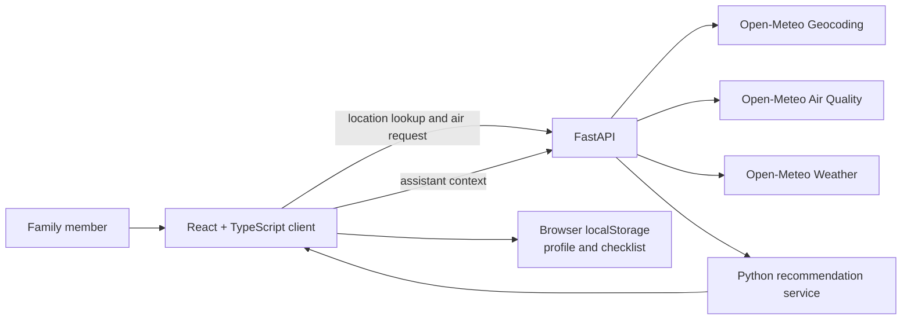

# AirAware AI

AirAware AI is a family-focused air quality and sustainable living companion for urban communities. It turns measured outdoor conditions into practical suggestions for a household, offers cautious indoor air guidance, and separates personal exposure choices from greenhouse gas estimates.

## Challenge vertical and problem

**Family Health & Sustainable Urban Living.** Families navigating winter smog need more than an AQI number: they need help deciding when to exercise, how to ventilate safely, and which routines can be changed without expensive equipment. AirAware makes those choices contextual and explains the limits of its information.

Primary persona: an urban Indian household with children, working adults, and possibly older members. The profile also supports other household structures and optional respiratory sensitivity preferences.

## Features

- Live outdoor AQI (explicitly the US AQI system), PM2.5, PM10, weather, and hourly model forecast through Open-Meteo.
- Optional browser geolocation and manual city lookup; no location permission is needed.
- Personal household profile persisted locally in the browser.
- A conversational assistant with a working deterministic fallback that is explicitly labeled rule-based.
- Family recommendations, flexible daily routine, indoor air checklist, and practical ventilation guidance.
- Transparent transport CO2e estimate with cited reference factors and a separate personal exposure explanation.
- Community education cards clearly marked as demonstration content; no location-level community data is collected.

## Architecture



The frontend is a Vite application in `frontend/`. FastAPI routes, data retrieval, validation and decision rules are separated under `backend/app/`. Upstream requests have timeouts and a ten-minute in-memory cache. On request failure the API returns an error; the UI hides measurements rather than showing fabricated or stale sample readings.

## AI architecture and decisions

The assistant uses a deterministic Python rules engine when no provider is configured. API replies identify that mode as `rule-based`; the interface labels it. This fallback works without a paid provider and gives a structured situation summary, action, reason, benefit, confidence limitation and alternative. The frontend also has a local rule fallback when the backend cannot be reached.

The AQI thresholds use US AQI category boundaries: Good 0–50, Moderate 51–100, Unhealthy for Sensitive Groups 101–150, Unhealthy 151–200, Very Unhealthy 201–300, and Hazardous 301+. Outdoor exertion is discouraged in very poor conditions; profile flags add conservative context. Ventilation advice always checks outdoor conditions first and notes combustion appliance ventilation. The engine does not diagnose or prescribe.

An optional OpenAI-compatible Chat Completions adapter is available on the backend. It is activated only when `LLM_API_KEY` and `LLM_MODEL` are set. Provider responses must be valid JSON with the required fields, are length-limited, and fall back to rules on errors or malformed output. The provider receives the submitted question plus the current air object and saved family profile. Configure this only if that data transfer is acceptable. Secrets stay on the backend and are never exposed through Vite variables.

## Data sources and attribution

- Open-Meteo Air Quality API provides model-based PM2.5, PM10, and US AQI estimates and hourly forecast: [API documentation](https://open-meteo.com/en/docs/air-quality-api).
- Open-Meteo Weather API supplies current temperature, relative humidity and wind: [API documentation](https://open-meteo.com/en/docs).
- Open-Meteo Geocoding API resolves manual city names: [Geocoding API](https://open-meteo.com/en/docs/geocoding-api).
- AQI category names follow the [US EPA AQI basics](https://www.airnow.gov/aqi/aqi-basics/).

Open-Meteo readings are model outputs, not a personal monitor or regulatory station measurement. The application displays the AQI index system and source and does not substitute demo values when data is absent.

## Environmental impact methodology

The transport estimator uses:

`estimated avoided CO2e = round-trip distance × (reference solo-car factor − alternative factor)`

The gasoline reference factor is approximately 400 g CO2e/mile as published by the [US EPA](https://www.epa.gov/energy/greenhouse-gas-equivalencies-calculator-calculations-and-references), converted to 0.249 kg/km. Bus (0.10151 kg/passenger-km) and average light rail (0.02444 kg/passenger-km) are from the [UK Government 2026 conversion-factor methodology](https://assets.publishing.service.gov.uk/media/6a2940543b15d05a7ce3202e/2026-GHG-conversion-factors-methodology-report.pdf). Walking and cycling are modeled as zero operating emissions; carpool assumes two occupants. Factors come from different geographies and are illustrative comparisons, not India-specific trip estimates. Occupancy, routes, vehicle efficiency, grid mix and services change real outcomes. This estimate is not a measure of personal PM2.5 exposure.

## Run locally

Requirements: Node.js 20+ and Python 3.10+.

1. Set environment variables as needed. For Vite, copy `.env.example` to `frontend/.env` and edit `VITE_API_URL`. Set backend variables in the backend process environment.
2. Start the backend:

   ```powershell
   cd backend
   python -m venv .venv
   .\.venv\Scripts\Activate.ps1
   pip install -r requirements.txt
   uvicorn app.main:app --reload
   ```

3. In another terminal start the frontend:

   ```powershell
   cd frontend
   npm install
   npm run dev
   ```

Open `http://localhost:5173`. Internet access is required for live location and environmental data. Without the backend, the interface and local checklist/profile still work and measurements remain unavailable.

## Deploy on Netlify

The root `netlify.toml` configures the site to build from `frontend/`, publish `frontend/dist`, and route browser paths back to the React entry point. Connect the GitHub repository to Netlify and use the detected configuration. The Netlify-hosted frontend can render without the API, but live readings require deploying `backend/` separately. Set the Netlify environment variable `VITE_API_URL` to that backend's HTTPS URL. On the backend, set `FRONTEND_ORIGINS` to the exact Netlify site origin (for example, `https://your-site.netlify.app`) so browser API calls pass CORS checks.

## Configuration

| Variable | Purpose |
|---|---|
| `VITE_API_URL` | Backend URL used by the browser (default `http://localhost:8000`) |
| `OPEN_METEO_TIMEOUT_SECONDS` | Upstream API timeout (default 8 seconds) |
| `FRONTEND_ORIGINS` | Comma-separated browser origins allowed by FastAPI; include your deployed Netlify origin |
| `LLM_API_KEY`, `LLM_BASE_URL`, `LLM_MODEL` | Optional backend-only OpenAI-compatible assistant provider; leave key/model blank for rules-only mode |

Never put a provider secret in a `VITE_` variable. No credentials are required for the implemented features.

## Tests

Run backend tests from `backend/`:

```powershell
pytest
```

Tests cover missing and valid environmental payloads, forecast parsing, household-sensitive recommendations, severe conditions, no-data fallback, and structured assistant responses.

## Privacy, safety and limitations

Profile and checklist preferences are stored only in localStorage on the device. They are not sent with air-data requests; profile context is sent to the assistant endpoint only when a question is submitted. If an LLM provider is configured, that request also passes to the selected provider. Coordinates are sent to the backend only to fetch requested environmental data. Avoid sharing sensitive diagnoses; the optional sensitivity switch stores only a boolean.

This is general environmental guidance, not medical advice. Seek professional guidance for individual health questions and emergency help for serious breathing difficulty. HEPA filtration can reduce particles when properly sized and maintained but does not remove all gases. Do not obstruct required ventilation or combustion appliance flues. The application does not claim houseplants clean typical homes or recommend ozone devices.

Live availability, local representativeness, sensor/model accuracy, and future forecasts are not guaranteed. City geocoding picks the first match; browser location can improve precision. The optional provider has no in-product configuration UI, formal user accounts, community telemetry, route planning, or indoor sensors.

## Future improvements

- Add provider-specific structured-output integration tests and model quality evaluation.
- Integrate trusted local monitoring networks and official country-specific AQI guidance.
- Add household-customizable schedules and route-aware commute exposure estimates.
- Replace cross-country transport reference factors with maintained, location-appropriate inventories.
- Add accessible automated browser coverage and deployable rate limiting.
